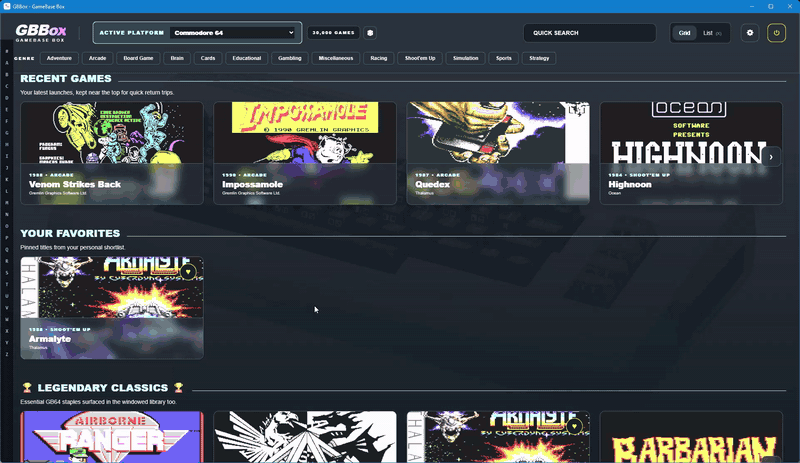
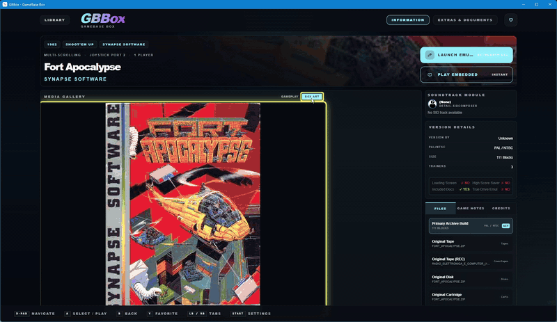
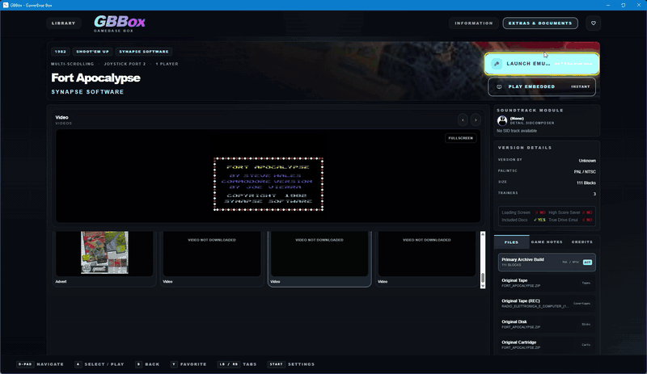
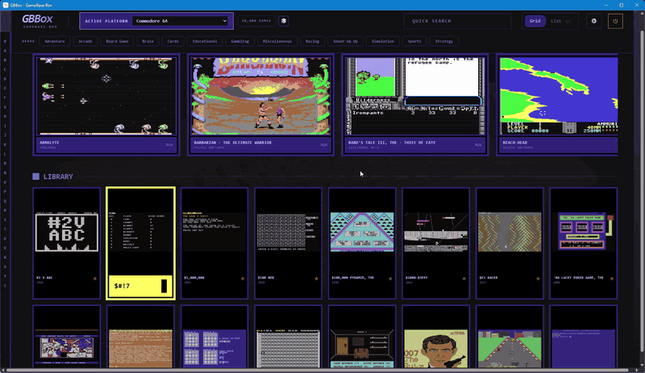
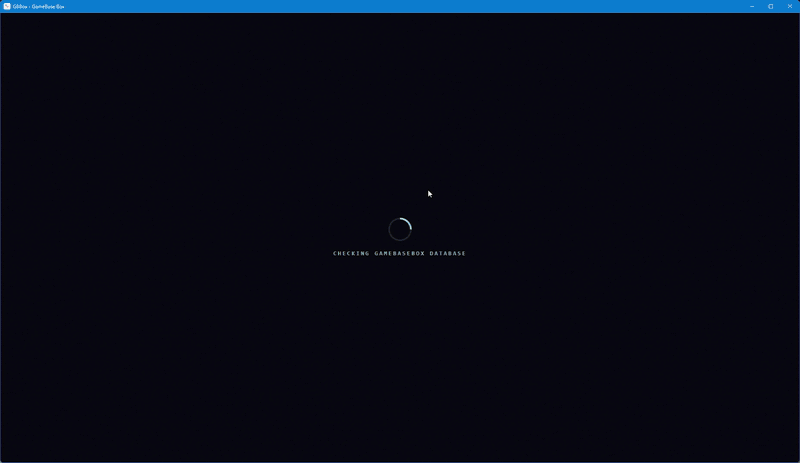
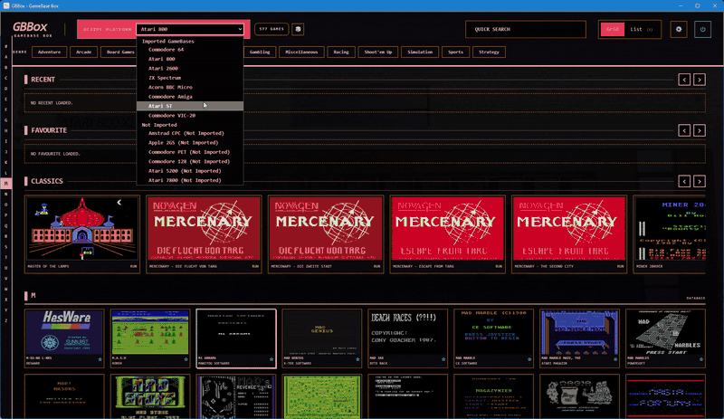
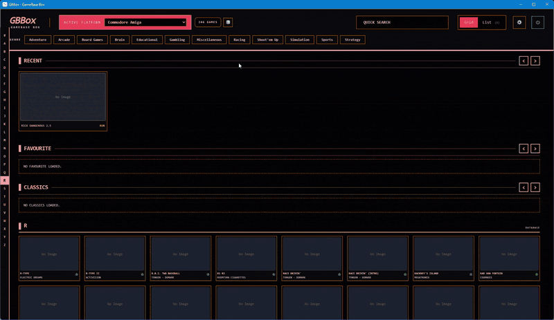

# GameBase Box

**GameBase Box** is a desktop frontend for [GameBase](https://gb64.com/) game libraries. It supports platform-scoped imports for **Commodore 64, Commodore 128, Commodore VIC-20, Commodore PET, Commodore Amiga, Atari 800, Atari 2600, Atari 5200, Atari 7800, Atari ST, ZX Spectrum, Acorn BBC Micro, Amstrad CPC, and Apple 2GS**.

GitHub Pages: [GameBaseBox](https://ejber-ozkan.github.io/GameBaseBox/)

## Download

Download the latest GBBox build from the platform links below, or browse the full [GitHub Releases page](https://github.com/ejber-ozkan/GameBaseBox/releases/latest).

Install the latest single executable application release and run it, no need to build it yourself!

<table>
  <tr>
    <td align="center">
      <a href="https://github.com/ejber-ozkan/GameBaseBox/releases/latest/download/GBBox-Windows-x64-Setup.exe">
        <br>
        Windows
      </a>
    </td>
    <td align="center">
      <a href="https://github.com/ejber-ozkan/GameBaseBox/releases/latest/download/GBBox-Linux.AppImage">
        <br>
        Linux
      </a>
    </td>
    <td align="center">
      <a href="https://github.com/ejber-ozkan/GameBaseBox/releases/latest/download/GBBox-macOS.dmg">
        <br>
        macOS
      </a>
    </td>
  </tr>
</table>

### C64 Library Browsing & Filtering


### Game Details & Video Previews


### Theme Customization & Settings


### C64 Edition Theme & In-App SID Player


### Multi-Platform Libraries (Atari 800 & Amiga)



### Cyberpunk CRT Theme & Navigation


Grateful to the GameBase64 project and GB64 Team for decades of Commodore 64 preservation. Visit [gb64.com](https://gb64.com/) for the original project.

GameBase database (`.mdb`) files, ROMs, screenshots, music, extras, and other media are not included. You point GBBox at the databases and local folders you own.

## Supported Imports

| Platform | Status | Notes |
|----------|--------|-------|
| Commodore 64 / GameBase64 | Supported | Compatibility baseline with VICE, RetroArch, in-app WASM emulation, SID playback, extras, screenshots, and GameBase64 metadata. |
| Commodore 128 | Supported | Imports GameBase C128 MDBs with Extras, Games, Screenshots, Musician Photos, and SID music folders. VICE x128 and RetroArch support. |
| Atari 800 | Supported | Imports Atari 800 v12-compatible GameBase MDBs with Games, Music, Photos, Screenshots, and Extras folders. Supports RetroArch Atari800 and Altirra launch settings. |
| Atari 2600 | Supported | Imports Atari 2600 GameBase MDBs with in-app WASM emulation, Games, Screenshots, and Extras folders. Uses RetroArch/Stella-style launch settings. |
| ZX Spectrum / GameBaseZX / SpeccyMania | Supported | Imports Sinclair ZX Spectrum v6-compatible GameBase MDBs with in-app WASM emulation, Extras, Games, Screenshots, Musician Photos, and Music folders. RetroArch and Spectaculator support. `.ay` chip music recognized. |
| Acorn BBC Micro | Supported | Imports BBC Micro GameBase MDBs with Extras, Games, Screenshots, and Music folders. RetroArch and BeebEm support. |
| Commodore Amiga | Supported | Imports Amiga GameBase MDBs with Extras, Games, Screenshots, and Music folders. RetroArch and WinUAE / UAE support. |
| Atari ST | Supported | Imports Atari ST GameBase MDBs with Extras, Games, Screenshots, and Music folders. RetroArch, STeem, and Hatari support. |
| Commodore VIC-20 | Supported | Imports VIC-20 v4.0+ GameBase MDBs with in-app WASM emulation, Extras, Games, Screenshots, and Music folders. RetroArch and VICE VIC-20 support. |
| Amstrad CPC / AmstradMania | Supported | Imports Amstrad CPC (AmstradMania v7+) GameBase MDBs with Extras, Games, Screenshots, Photos, and AY music folders. Caprice32 / CPC++ and RetroArch support. |
| Apple 2GS | Supported | Imports Apple 2GS GameBase MDBs with Extras, Games, Screenshots, Photos, and Music folders. KEGS and RetroArch support. |
| Commodore PET | Supported | Imports Commodore PET (v3.1+) GameBase MDBs with Extras, Games, and Screenshots folders. VICE xpet and RetroArch support. |
| Atari 5200 | Supported | Imports Atari 5200 GameBase MDBs with Extras, Games, Screenshots, and Photos folders. Altirra and RetroArch desktop support. |
| Atari 7800 | Supported | Imports Atari 7800 GameBase MDBs with Extras, Games, and Screenshots folders. RetroArch ProSystem desktop support. |

## Some of the many features

- **GameBase-style library frontend**: Browse imported collections in windowed mode or fullscreen BigBox mode.
- **Platform-scoped libraries**: Keep catalog data, media roots, emulator paths, favorites, and navigation state separate per platform.
- **Fast search and filtering**: Search by title and metadata, browse by genre/subgenre, and jump alphabetically through large collections.
- **Native emulator bridge**: Launch through VICE, RetroArch, Altirra, and platform-specific emulator profiles where supported.
- **In-app C64 emulation**: Play supported Commodore 64 games through the bundled EmulatorJS/VICE core.
- **Multi-file launch handling**: Generate temporary `.vfl` or `.m3u` launch artifacts for multi-disk and multi-file games. This approach also 'just works for BBC, Apple2gs and Amiga platforms.
- **Media and extras browsing**: View screenshots, box art, photos, manuals, maps, adverts, books, and other extras from local folders.

### Example Setup for Commodore 64

1. Download the GameBase64 `GBC_v19.mdb` file from the [GameBase64 website](http://www.gamebase64.com/).
2. Prepare your local GameBase64 folders for Games, Screenshots, Photos, Music/SID, Extras, BoxArt, and Video where available.
3. In GBBox, import the database and configure **C64 Platform Paths** in Settings.

Same goes for other platforms, download the database from the GameBase website for the platform you want to import and follow the same steps.

If a recognised Gamevideoarchive file is missing locally, its video panel can download an available Archive.org MP4 derivative into the expected Extras subfolder; the original database path is not changed. (May require local ffmpeg installed)

## Prerequisites to build it yourself

- [Node.js](https://nodejs.org/en) v24+
- [Rust](https://rustup.rs/) for the Tauri backend
- [Tauri CLI prerequisites](https://tauri.app/2/guides/getting-started/prerequisites/)
- Linux packages on Ubuntu/Debian:

```bash
sudo apt update
sudo apt install libwebkit2gtk-4.1-dev build-essential curl wget libssl-dev libgtk-3-dev libayatana-appindicator3-dev librsvg2-dev mdbtools
```

## Setting up Platform Databases and Assets

### Building the SQLite Database

GBBox converts GameBase Access (`.mdb`) exports into an optimized local SQLite database. The conversion step creates performance indexes, persisted cover lookup, platform library metadata, and full-text search support objects.

#### Windows

Install the Microsoft Access Database Engine / Access ODBC components:

- [Microsoft Access Database Engine 2016 Redistributable](https://www.microsoft.com/en-us/download/details.aspx?id=54920)

Microsoft support for that download ended on October 14, 2025, but it remains the official source for the MDB export tooling used here.

```bash
.\scripts\import_gb64.bat
```

#### Linux and macOS

Install dependencies, then run the audited import wrapper:

```bash
npm install csv-parse better-sqlite3
./scripts/import_gb64.sh
```

Manual conversion still works:

```bash
./scripts/mdb-export-all.sh ./GBC_v19.mdb
node ./scripts/convert_csv_to_sqlite.js
node ./scripts/check_sqlite_support.js
```

## Development

```bash
npm install

# Windows
.\tauri-dev.bat

# Linux/macOS
npm run tauri dev
```

### Debug Mode

GBBox includes a built-in debug logging mode that prints warnings to the console when images or media files cannot be resolved. This is useful for diagnosing "No Image" issues caused by mismatched folder structures or filename casing.

### Launching the installed app with debug output

Open a terminal, navigate to where GBBox is installed, and add the `--debug` flag:

**Windows (PowerShell or Command Prompt)**

```powershell
# Typical install location
& "C:\Program Files\GBBox\GBBox.exe" --debug

# Or from the install folder directly
.\GBBox.exe --debug
```

**macOS (Terminal)**

```bash
# From the app bundle
/Applications/GBBox.app/Contents/MacOS/GBBox --debug

# Or using open with args
open -a GBBox --args --debug
```

**Linux**

```bash
# AppImage
./GBBox.AppImage --debug
```

> **Tip**: The short form `-d` also works on all platforms.

### What debug output looks like

When an image cannot be found you will see lines like:

```
[DEBUG] Debug logging enabled via CLI flag.
[DEBUG WARNING] Failed to resolve media file "game_screenshot.png" under base directory "E:/Screenshots". Tried candidates: [...]
[DEBUG WARNING] No media variants found for "game_cover.png" under base directory "E:/BoxArt"
```

These messages show exactly which filename GBBox looked for and which directories it searched, making it straightforward to spot folder path mismatches or missing files.

### Alternative: environment variable

If you prefer not to type the flag every time, set `GAMEBASEBOX_DEBUG=1` in your environment before launching normally (via shortcut, Finder, or file manager):

**Windows (PowerShell, current session only)**

```powershell
$env:GAMEBASEBOX_DEBUG = "1"
# Then launch via shortcut or Start menu - debug mode will be active
```

**macOS / Linux**

```bash
export GAMEBASEBOX_DEBUG=1
# Then launch normally
```

### Persistent log files

All debug output and warnings are also persistently written to log files in the standard application log directories on your system:

* **Windows**: `%APPDATA%\com.gamebasebox.desktop\logs\main.log`
* **macOS**: `~/Library/Logs/com.gamebasebox.desktop/main.log`
* **Linux**: `~/.cache/com.gamebasebox.desktop/logs/main.log`

## Production Build

```bash
# Windows
.\tauri-build.bat

# Linux/macOS
npm run tauri build
```

Build artifacts are written under `src-tauri/target/release/bundle/`.

## Post-Setup Configuration

Open **Settings** from the top header bar:

1. Configure each imported platform under its own **Platform Paths** page.
2. For C64, choose VICE or RetroArch and set the executable/core paths.
3. For Atari 800, choose RetroArch Atari800 or Altirra and set the required paths.
4. For Atari 2600, set RetroArch and the Atari 2600 core path.
5. For BBC Micro, choose RetroArch BBC Micro or BeebEm and set the required paths.
6. For Amiga, choose RetroArch Amiga or WinUAE/UAE and set the required paths.
5. Set media and extras folders for each platform so screenshots, photos, manuals, maps, and alternate versions resolve from your local collection.

## Release Notes

The [0.7.0 release notes](RELEASE_NOTES_0.7.0.md) describe the changes, known limitations and rollback guidance.

See [CHANGELOG.md](CHANGELOG.md)

Yes! built and wrangled with several different AI Harnesses.
